# ScoutHub

ScoutHub is a Django-based web application designed for football enthusiasts and scouts to track top league teams and players, as well as create and manage their personal scouting reports. The application integrates with an external Football API to provide up-to-date data.


## 📑 Table of Contents
1. [💡 Rationale and Purpose](#rationale-and-purpose)
2. [✨ Features](#features)
3. [🚀 Development Walkthrough](#development-walkthrough)
    * [1: Paper Work](#1-paper-work)
    * [2: Figma](#2-figma)
    * [3: Agile Board](#3-agile-board)
    * [4: Putting Idea into Live](#4-putting-idea-into-live)
    * [5: Bugs and Debugging](#5-bugs-and-debugging)
    * [6: Comes to Life](#6-comes-to-life)
4. [🧠 User Experience (UX) & Accessibility](#user-experience-ux--accessibility)
5. [📱 Responsiveness](#responsiveness)
6. [🛠️ Technologies Used](#technologies-used)
7. [⚙️ Testing](#testing)
8. [🧾 Version Control](#version-control)
9. [📂 File Structure](#file-structure)
10. [🧰 Code Structure and Logic](#code-structure-and-logic)
11. [🌱 Future Improvements](#future-improvements)
12. [🚀 Deployment](#deployment)
13. [🤝 Contributing](#contributing)
14. [📝 Credits](#credits)
15. [✔️ Post-Deployment Tasks](#post-deployment-tasks)
16. [⚖️ License](#license)

---

## 💡 Rationale and Purpose

The primary goal of ScoutHub is to empower football enthusiasts, scouts, and analysts with a centralized platform to manage and analyze critical player and team data. It addresses the need for an intuitive tool to:

-   **Centralize Scouting Data:** Provide a dedicated space for users to create, store, and manage their personal scouting reports, moving beyond scattered notes and spreadsheets.
-   **Leverage Real-time Data:** Integrate with external football APIs to ensure reports and analysis are based on up-to-date league standings, team performance, and player statistics.
-   **Enhance Decision-Making:** Offer tools that facilitate deeper analysis of player attributes and team dynamics, aiding in informed decision-making for talent identification and tactical planning.
-   **Streamline Workflow:** Simplify the process of report creation, editing, and organization, saving time for busy scouts and enthusiasts.

Ultimately, ScoutHub aims to be an indispensable resource for anyone serious about understanding and evaluating football talent.

---

## Features

### Core Functionality
-   **User Authentication:** Secure registration, login, and logout functionalities.
-   **Dashboard:** Personalized dashboard for logged-in users to manage their reports.
-   **Homepage Data Display:** Dynamically displays top 5 league teams (with position, points, form) and top 5 players (with goals, assists) from a selected league.
-   **Scouting Report Management (CRUD):**
    -   **Create:** Users can create new scouting reports using a dynamic form where team selection populates relevant players. Includes client-side validation and a disabled save button until the form is complete.
    -   **Read (List):** View a paginated list of all created reports on the user dashboard.
    -   **Read (Detail):** Access a detailed view for individual reports.
    -   **Edit:** Modify existing reports via a pre-filled form with data validation and success messages.
    -   **Delete:** Users can delete the scouting reports they created easly with cleare delete Button .
    -   **Delete:** Delete confirmation message will popup after delete Button is trigerd to confirm deletion .

-   **Data Synchronization:** Management command to fetch and update football data from the API, respecting rate limits.

---

## Development Walkthrough

This section details the journey of ScoutHub, from initial concepts to a live application, touching upon design, agile methodologies, and bug resolution.

---

### 1: Paper Work

Here's where it all began, sketching out the core ideas and structure before a single line of code was written.

-   **Idea**: The initial spark – a platform for football scouting.
-   **Design**: High-level concepts and user flows.
-   **ERD (Entity-Relationship Diagram)**: Mapping out the database structure and relationships between models like `User`, `Team`, `Player`, and `Report`.
-   **Wireframe**: Basic visual layouts to understand user interface and interaction.


<div style="text-align: center;">
    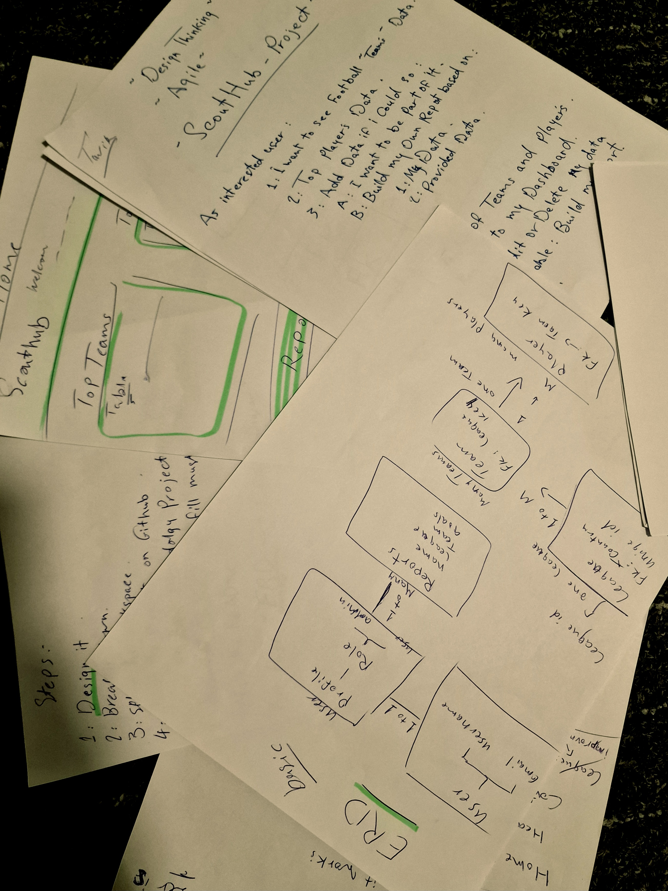
</div>

---

### 2: Figma

Translating initial sketches into more refined digital designs.

-   **Home Page Design**:

<div style="text-align: center;">
    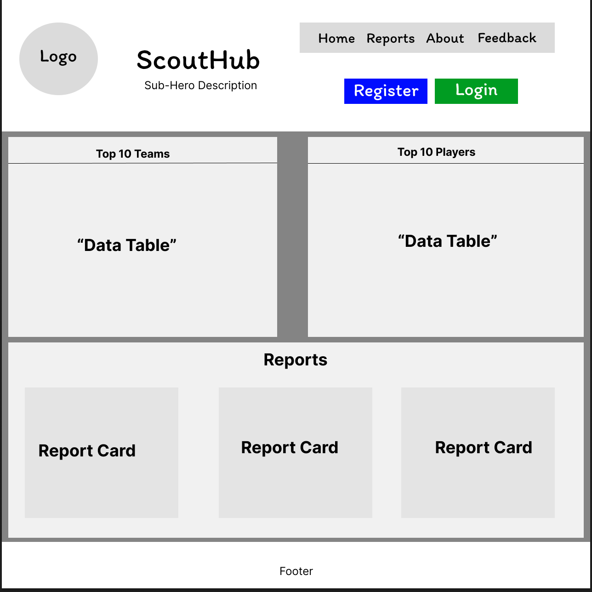
</div>

-   **Dashboard Design**:

<div style="text-align: center;">
    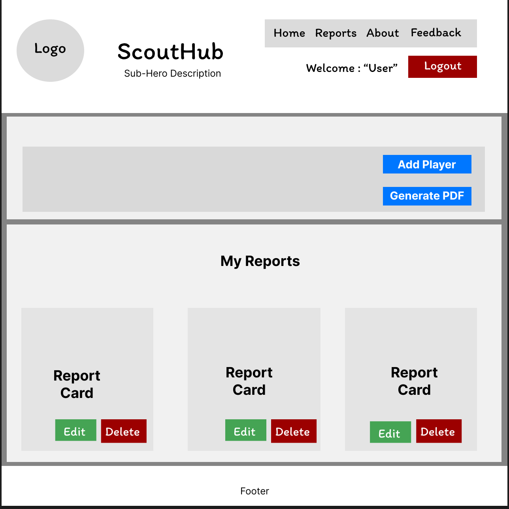
</div>

---

### 3: Agile Board

Our development process followed an Agile approach, managing tasks and user stories on a GitHub Project board.
💡 [Project Board](https://github.com/users/Tarik-Box/projects/12)

-   **Project Creation**:
    We set up our Agile project board on GitHub, following the **MoSCoW (Must Have, Should Have, Could Have, Won't Have)** approach for prioritization. This helped us categorize user stories based on their criticality for the project's success.
    -   **Must Have**: Essential for the core functionality of the application.
    -   **Should Have**: Important features that significantly improve the user experience but are not critical for launch.
    -   **Could Have**: Nice-to-have features that can be implemented if time permits.
    -   **Won't Have**: Features explicitly decided against for the current iteration.

    This structured approach ensured we focused on delivering the most valuable features first.

    *User Stories - Examples:*

<div style="text-align: center;">
    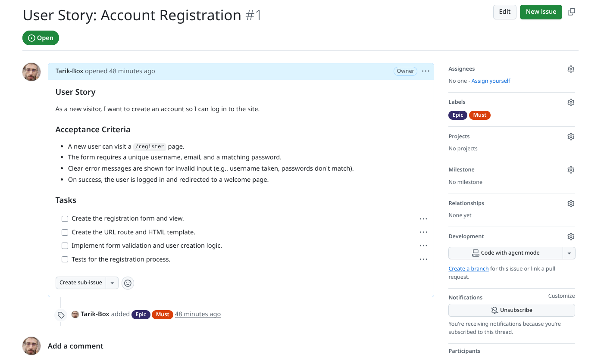
</div>

<div style="text-align: center;">
    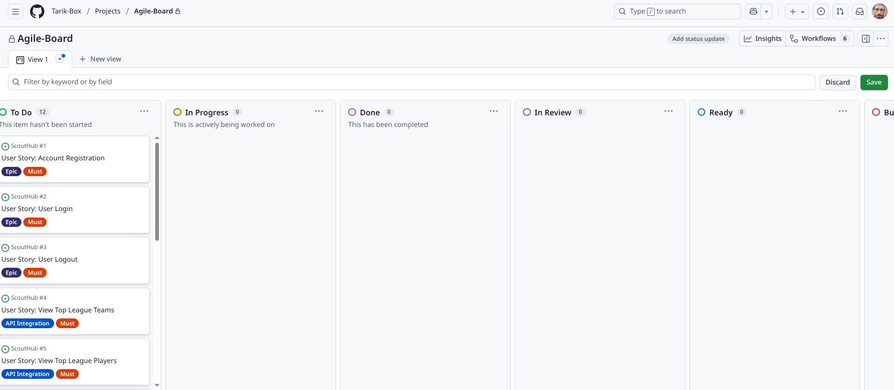
</div>

<div style="text-align: center;">
    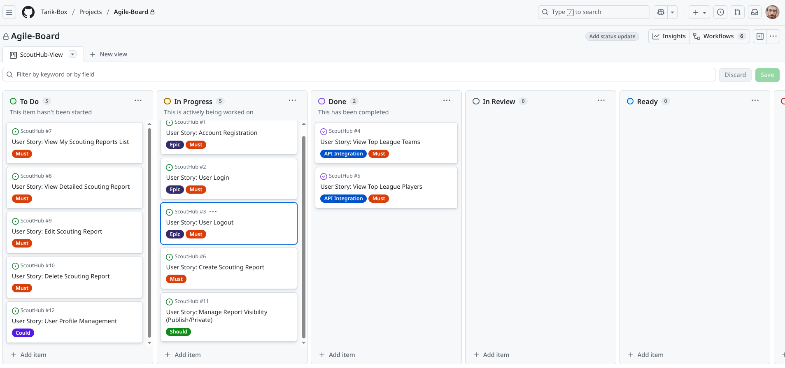
</div>

    I've decided to go start with US-#4 and #5 to setup the envioroment,API so we load data into the Home-Page first.

<div style="text-align: center;">
    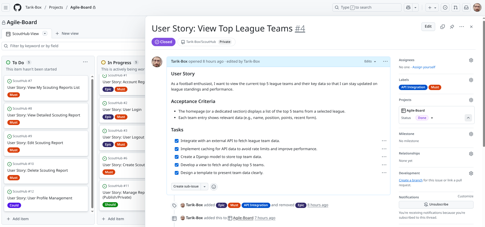
</div>

<div style="text-align: center;">
    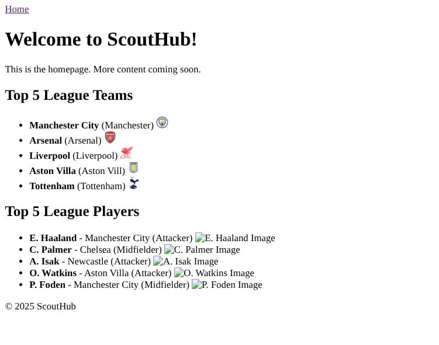
</div>

---

### 4: Putting Idea into Live

Getting the project off the ground with Django.

-   **Starting the Django Project**:
    The project was initialized using `django-admin startproject scout_hub .` to create the main project directory and essential files.
-   **Applications Created**:
    This project is structured into several Django applications to maintain modularity and clear separation of concerns:
    -   `accounts`: Handles user authentication (registration, login, logout) and profile management.
    -   `core`: Manages core football data models (Teams, Players, etc.) and API integrations.
    -   `web`: Contains general website pages like the homepage, about, and contact.
    -   `reports`: Manages the creation, viewing, editing, and deletion of scouting reports.
    -   `dashboard`: Provides the user-specific dashboard functionality.

---

### 5: Bugs and Debugging

Development isn't always smooth sailing! Here are some of the challenges encountered and how they were addressed.

*Bugs and Debugging - Examples:*

#### Corrupted Commit Message (Fixed)
During development, a commit message for `8ccf41f` (later removed via force push) was accidentally corrupted, including unintended script usage output. This was due to an oversight in handling multi-line strings in the `git commit` command within the environment.

**Resolution:** The commit was completely removed from the repository history using `git reset --hard` and `git push --force`, and the changes were re-committed with a corrected message.


#### Database Backend Mismatch (Resolved)
After attempting to switch the database backend from SQLite to PostgreSQL and resolving a corrupted commit message via `git reset --hard` and re-commit, the project inexplicably reverted to using SQLite. This occurred despite `scout_hub/settings.py` being correctly configured for PostgreSQL via `DATABASE_URL` from `.env`. All migrations, superuser accounts, and fetched API data were being stored in `db.sqlite3`.

**Resolution:** The issue stemmed from an unclear state of the PostgreSQL database. The fix involved:
1. **Create a new Free Account on "neon.tech"** to ensure a fresh PostgreSQL database ready to use .
2.  **Cleaning Local State:** Deleting `db.sqlite3` and all existing `core` app migrations (`0*.py` files).
3.  **Rebuilding Database:** Running `makemigrations`, `migrate`, `createsuperuser`, and `fetch_football_data` to populate the newly reset PostgreSQL database.
This process successfully switched the project to use PostgreSQL as the backend database.


#### Player Image Not Displayed (Resolved)
The player images were not displaying on the homepage due to a typo in the `web/templates/web/home.html` template. The template was incorrectly trying to access `player.image.url` assuming `image` was an ImageField, whereas the `Player` model uses a `URLField` named `image_url`.

<div style="text-align: center;">
    
</div>

**Resolution:** The template reference was corrected from `player.image.url` to `player.image_url`.

<div style="text-align: center;">
    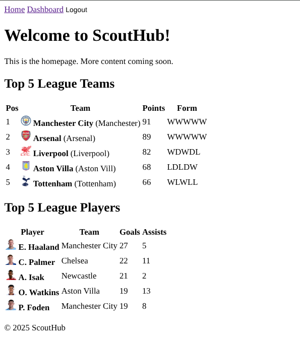
</div>

#### NoReverseMatch for 'login' URL (Resolved)
When attempting to access the registration page (`/accounts/register/`), a `NoReverseMatch` exception was raised, indicating that the URL pattern named 'login' could not be found. This occurred because the registration template (`register.html`) contained a link to ``, but the `login` URL pattern was defined within the `accounts` app namespace.

<div style="text-align: center;">
    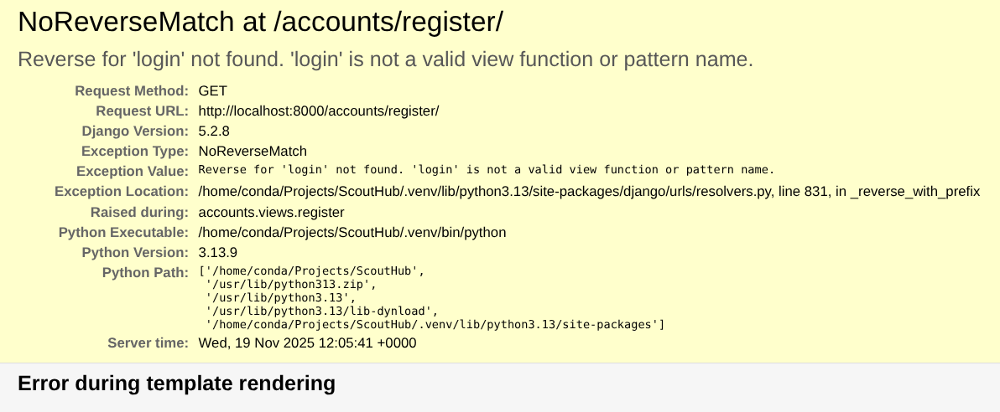
</div>

**Resolution:** The template reference in `accounts/templates/accounts/register.html` was corrected from `` to `` to use the namespaced URL.


#### Dependent Player Dropdown Not Populating (Resolved)
The "Create Report" form includes a "Team" dropdown and a "Player" dropdown that should be dynamically populated via JavaScript. When a team was selected, the player dropdown remained empty.

<div style="text-align: center;">
    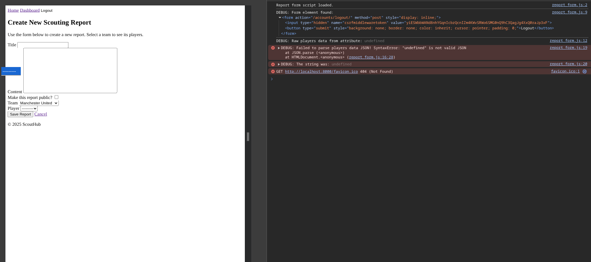
</div>

**Resolution:** The bug was traced through a multi-step debugging process.
1.  **Initial Hypothesis:** The first assumption was that the JSON data being passed from the Django view to the template was being improperly escaped. This was addressed by applying the `|safe` filter in the template, but the bug persisted.
2.  **Instrumenting the Code:** To get visibility into the script's execution, the JavaScript file (`report_form.js`) was modified to include extensive `console.log()` statements at every step: reading the data, parsing the JSON, finding the form elements, and handling the `change` event.
3.  **Browser Console Analysis:** The browser's developer console revealed the root cause. A "DEBUG" message showed that the script was finding a `<form>` element, but it was the wrong one: `<form action="/accounts/logout/">`.
4.  **Root Cause Identified:** The JavaScript selector `document.querySelector('form')` was too generic. It. was selecting the first form in the DOM, which happened to be the logout form in the `base.html` navigation bar, not the intended report creation form. This logout form lacked the `data-players-data` attribute, causing the script to fail with an `"undefined" is not valid JSON` error.
5.  **The Fix:**
    *   A unique ID, `id="create-report-form"`, was added to the `<form>` tag in the `reports/templates/reports/create_report.html` template.
    *   The JavaScript selector was updated to the more specific `document.querySelector('#create-report-form')` to guarantee it selected the correct form.
This change resolved the issue, and the dropdowns now function as expected.

<div style="text-align: center;">
    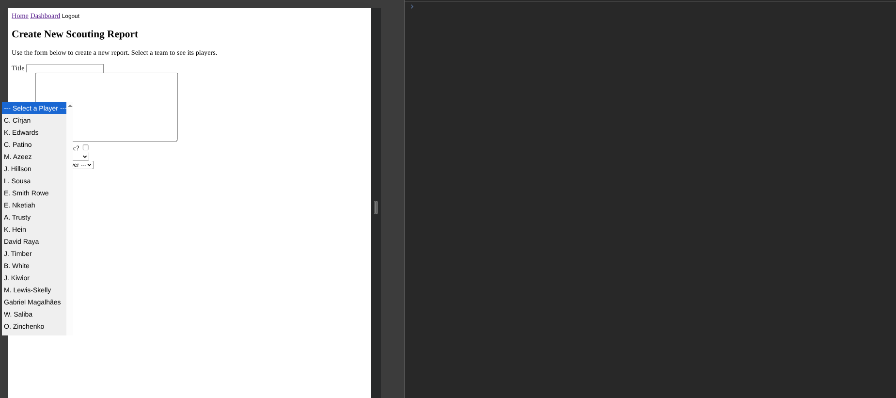
</div>


#### Incomplete Form Submission Allowed (Resolved)
The "Create Report" form allowed submission even when required fields like 'player' or 'title' were left empty. While server-side validation would catch this, it provided a poor user experience.

**Resolution:** The form's UX was improved with client-side validation.
1.  **Root Cause Identified:** The form lacked real-time client-side validation to prevent the user from clicking "Save" on an incomplete form.
2.  **The Fix:**
    *   The "Save Report" button was disabled by default in the HTML template.
    *   The `report_form.js` script was refactored to add event listeners to all required inputs (`title`, `content`, `team`, `player`).
    *   A validation function now runs on every input change, checking if all required fields are filled. The "Save Report" button is only enabled when the entire form is valid, providing immediate visual feedback to the user.


---


### 6: Comes to Life

The first glimpses of the working application.

*Examples: how it worked and evolved*

*First Creation:*

<div style="text-align: center;">
    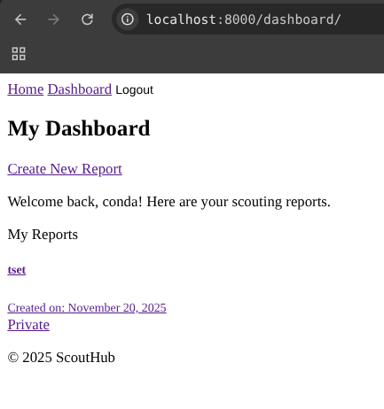
</div>


*First Updating:*

<div style="text-align: center;">
    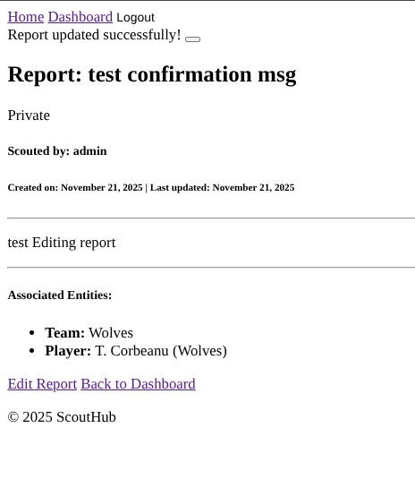
</div>

*Deletion & Confirmation:*


<div style="text-align: center;">
    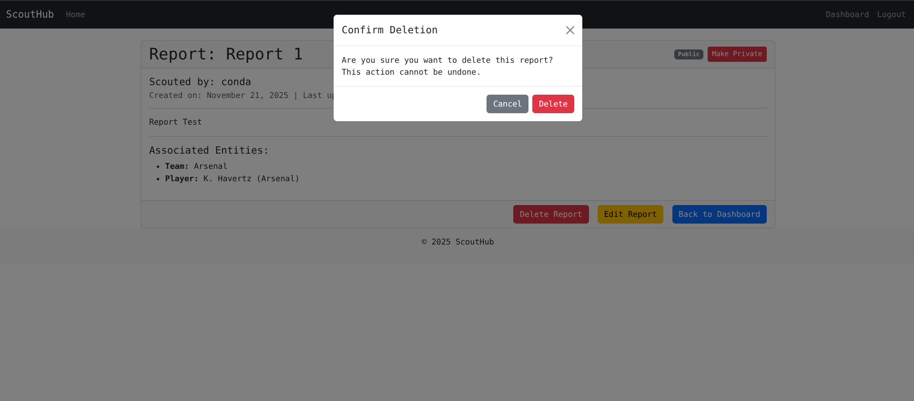
</div>

*Vivibility Also Works:*


<div style="text-align: center;">
    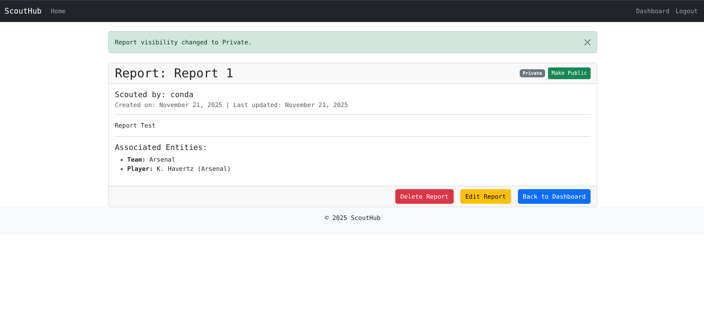
</div>

---

## 🧠 User Experience (UX) & Accessibility

ScoutHub is designed with a focus on delivering a smooth and intuitive user experience (UX) for all users, alongside robust accessibility (A11y) to ensure broad usability.

### User Experience (UX)
The application guides users through a clear and logical flow:
-   **Browse** available football data on the homepage.
-   **Register/Login** to unlock personalized features.
-   **Manage Reports**: Create, Read, Update, Delete personal scouting reports.
-   **Download Reports**: Generate PDF versions of scouting reports for offline use.

Key UX principles applied include:
-   **Clarity**: Simple and direct language, intuitive navigation.
-   **Feedback**: Immediate visual feedback for user actions (e.g., form validation, success messages).
-   **Consistency**: Uniform design elements and interaction patterns throughout the application.
-   **User Control**: Users are in control of their actions, with clear options for undoing or confirming critical operations.

### Accessibility Features
ScoutHub is built with accessibility in mind, utilizing fundamental semantic HTML5 elements to ensure a clear and navigable structure for all users, including those using assistive technologies.

-   **Semantic Structure**: Key elements like `<header>`, `<nav>`, `<main>`, `<section>`, `<footer>`, `<button>`, `<a>`, and form elements are used appropriately to convey meaning and structure.
-   **Color Contrast**: Accessible color palettes are chosen to maintain sufficient contrast between text and background, aiding readability for users with visual impairments.
-   **Clear Navigation**: Logical tab order for keyboard navigation and clear focus indicators for interactive elements.
-   **Accessible Forms**: Form fields are properly labeled and associated using `<label>` tags, and error messages are clearly conveyed.
-   **ARIA Attributes**: Applied sparingly where native HTML semantics are insufficient to enhance the experience for assistive technologies (e.g., `aria-label` for descriptive buttons).
-   **Responsive Design**: Ensures usability across diverse devices and screen sizes (detailed in the Responsiveness section).

---

## 📱 Responsiveness

ScoutHub is designed to be fully responsive, providing an optimal viewing and interaction experience across a wide range of devices, from desktops to mobile phones.

### Strategy
*(To be detailed later: Explain the media query strategy "Mobile First", flexible layouts, and image handling.)*

### Screenshots
*(Placeholder for screenshots demonstrating responsiveness across different devices.)*

<div style="text-align: center;">
    
</div>

<div style="text-align: center;">
    
</div>

<div style="text-align: center;">
    
</div>

---

## 🛠️ Technologies Used

This project utilizes the following key technologies to deliver its features:

-   **Python 3.13.9**: The core programming language.
-   **Django**: The high-level Python Web framework.
-   **PostgreSQL**: The robust relational database management system.
-   **API-Football v3.co**: The external API providing comprehensive football data.
Note: The API-KEY used in this project is a free API_KEY, and therefore the data displayed may not always be the most up-to-date.
you can get a free API_KEY [here](https://www.api-football.com/)
-   **HTML5**: For semantic document structure.
-   **CSS3**: For styling, layout, and responsiveness, leveraging **Bootstrap 5** for a mobile-first and responsive design.
-   **JavaScript (Vanilla JS)**: For client-side interactivity, dynamic form elements, and enhanced user experience.
-   `**python-decouple**`: For secure management of environment variables.
-   `**requests**`: A popular HTTP library for making API calls.
-   `**dj-database-url**`: Simplifies database configuration by parsing connection strings.
-   `**whitenoise**`: For efficiently serving static files in production.
-   `**gunicorn**`: A production-ready WSGI HTTP server for deploying Django applications.
-   `**Black**`: An uncompromising Python code formatter, ensuring consistent code style across the project.
-   **Font Awesome**: For scalable vector icons.
-   **Google Fonts (Inter)**: Used for consistent and modern typography.


---

## 📂 File Structure

A high-level overview of the ScoutHub project's directory structure.

```
ScoutHub/
├── .venv/                   # Python virtual environment
├── accounts/                # Handles user authentication and profiles
├── assets/                  # Static assets like documentation images
├── core/                    # Manages core football data and API integration
├── dashboard/               # User-specific dashboard features
├── reports/                 # Manages scouting report CRUD operations
├── scout_hub/               # Main Django project settings and URLs
├── web/                     # General website pages (home, about, contact)
├── .gitignore               # Files/directories ignored by Git
├── manage.py                # Django's command-line utility
└── requirements.txt         # Python dependencies
```

---

## 🧰 Code Structure and Logic

This section provides insights into the overall architecture, key design patterns, and how different components of the ScoutHub application interact to deliver its functionality.

### Architectural Overview
ScoutHub is built upon the Django framework, which inherently follows a Model-View-Controller (MVC) architectural pattern, though Django often refers to it as Model-View-Template (MVT). Each application (`accounts`, `core`, `web`, `reports`, `dashboard`) within the project encapsulates a specific set of functionalities, promoting modularity and separation of concerns.

-   **Models (M)**: Defined in `models.py` within each app, these represent the data structure (e.g., `User`, `Team`, `Player`, `Report`). They handle data validation and interaction with the PostgreSQL database.
-   **Views (V)**: Implemented in `views.py`, these Python functions or classes receive web requests, interact with models to fetch/update data, process business logic, and determine which template to render in response.
-   **Templates (T)**: Stored in `templates/` directories, these HTML files (with Django's templating language) define the user interface. They display data passed from views and collect user input via forms.
-   **Forms**: Django Forms (`forms.py`) handle input validation and rendering, acting as an intermediary between views and templates.
-   **URLs**: Defined in `urls.py`, these map URL patterns to specific views, directing web traffic within the application.

### Key Logic Flow
The application's primary data flow involves:

1.  **API Data Ingestion**: The `core/management/commands/fetch_football_data.py` command fetches real-time football data (teams, players, standings) from API-Football v3.co, processing and storing it in the PostgreSQL database via `core/api_client.py` and the `core/models.py`.
2.  **User Authentication**: The `accounts` app manages user registration, login, and logout, utilizing Django's built-in authentication system and custom forms.
3.  **Homepage Display**: The `web` app's views query the `core` models to retrieve and display top league teams and players on the homepage.
4.  **Scouting Report Lifecycle**:
    *   **Creation**: Users access a form (from `reports/forms.py`) rendered by `reports/views.py`. Client-side JavaScript (`reports/static/reports/js/report_form.js`) dynamically populates player dropdowns based on team selection. Validated data is saved to `reports/models.py`.
    *   **Viewing/Editing/Deletion**: Reports are retrieved, displayed, and modified through views and templates in the `reports` app. Updates involve form validation, and deletions include confirmation steps.
5.  **User Profiles**: The `accounts` app's `profile_view` allows logged-in users to manage their basic account information (username, email) and extended profile details (`Profile` model).

---

## 🌱 Future Improvements

Ideas and potential enhancements for future iterations of the ScoutHub project, aimed at expanding functionality and improving user experience. This is just a sample of what could be improved, and much more could be enhanced to create a truly unique football analyzing web-based system:

-   **Advanced Search and Filtering**: Implement robust search capabilities for scouting reports, allowing users to filter by various criteria (e.g., player attributes, team, date, scout's rating).
-   **User Collaboration**: Introduce features for sharing reports with other users or teams, enabling collaborative scouting efforts.
-   **Notifications and Alerts**: Set up a notification system for important updates, such as new player data, upcoming matches for followed teams, or comments on shared reports.
-   **Statistical Visualization**: Integrate charts and graphs to visualize player performance trends, team statistics, and report data, offering deeper insights.
-   **PDF Report Customization**: Allow users to customize the layout and content of generated PDF reports.
-   **User Profile Enhancements**: Expand user profiles to include more social features or detailed statistics on their scouting activity.
-   **Integration with Live Data Feeds**: Explore direct integration with live match data for real-time scouting updates.

---

## 🚀 Deployment

Deploying ScoutHub to a production environment involves several key steps to ensure it runs efficiently and is accessible to users. This guide outlines the process for deployment using Heroku, a popular Platform-as-a-Service (PaaS). The detailed steps here are general and will be updated with more specific instructions as the project progresses past initial deployment.

### Prerequisites for Heroku Deployment
-   A Git repository (e.g., GitHub) with your project code.
-   A Heroku account and the Heroku CLI installed.
-   A PostgreSQL database service (Heroku provides PostgreSQL add-ons).
-   All dependencies listed in `requirements.txt`.

### Heroku Deployment Process

1.  **Prepare `settings.py` for Production**:
    *   Set `DEBUG = False`.
    *   Configure `ALLOWED_HOSTS` to include your Heroku app's domain (e.g., `your-app-name.herokuapp.com`).
    *   Ensure `SECRET_KEY` is retrieved from environment variables.
    *   Configure static file serving using `whitenoise`.
    *   Ensure database configuration uses environment variables (`dj-database-url`).

2.  **Create `Procfile`**:
    Create a `Procfile` in the root of your project to tell Heroku how to run your application.
    ```
    web: gunicorn scout_hub.wsgi --log-file -
    ```

3.  **Install Gunicorn & Whitenoise**:
    Ensure `gunicorn` (production-ready WSGI HTTP server) and `whitenoise` (for serving static files in production) are in your `requirements.txt`.
    ```bash
    pip install gunicorn whitenoise dj-database-url
    pip freeze > requirements.txt
    ```

4.  **Create Heroku App**:
    Log in to Heroku via CLI and create a new app:
    ```bash
    heroku login
    heroku create your-app-name
    ```

5.  **Add Heroku Postgres Add-on**:
    Attach a PostgreSQL database to your Heroku app:
    ```bash
    heroku addons:create heroku-postgresql:hobby-dev -app your-app-name
    ```
    This will automatically set the `DATABASE_URL` environment variable.

6.  **Configure Environment Variables on Heroku**:
    Set your API key and Django's secret key on Heroku:
    ```bash
    heroku config:set API_KEY="your_api_football_v3_key_here" -app your-app-name
    heroku config:set SECRET_KEY="a_strong_random_secret_key" -app your-app-name
    ```
    Replace placeholders with your actual keys.

7.  **Push to Heroku**:
    Deploy your code to Heroku:
    ```bash
    git push heroku main
    ```

8.  **Run Database Migrations**:
    Execute database migrations on Heroku to set up the production database schema:
    ```bash
    heroku run python manage.py migrate -app your-app-name
    ```

9.  **Fetch Initial Data**:
    Populate your production database with initial football data:
    ```bash
    heroku run python manage.py fetch_football_data --season_year=2023 --force_update -app your-app-name
    ```

Your ScoutHub application should now be live and accessible at `https://your-app-name.herokuapp.com`!

---

## 🤝 Contributing

We welcome contributions to ScoutHub! If you're interested in improving the project, please follow these guidelines:

### How to Contribute

1.  **Fork the Repository**: Grab your own copy of the project from `https://github.com/Tarik-Box/ScoutHub`.
2.  **Work on a Feature/Fix**: Create a new branch, implement your changes, and make sure everything is tested and working.
3.  **Commit Your Work**: Use clear commit messages that explain what you did.
4.  **Submit a Pull Request**: Propose your changes to the main repository for review. Provide a good explanation of your work!

### Code Style
-   **Python**: We stick to [PEP 8](https://www.python.org/dev/peps/pep-0008/) guidelines, using `Black` for automatic formatting.
-   **HTML/CSS/JavaScript**: Keep it consistent with the existing code – think semantic HTML, clean CSS, and modern JavaScript practices.

### Reporting Bugs
Found an issue? Please open a new issue on the GitHub repository and include:
-   A clear description of the bug.
-   Steps to reproduce it.
-   What you expected to happen vs. what actually happened.
-   Any relevant screenshots or details about your setup.

---

## 📝 Credits

This project was developed by **Tarik Box**.

### External Libraries and Resources
This project leverages several third-party libraries and APIs to function effectively:

-   **Django**: The high-level Python Web framework that encourages rapid development and clean, pragmatic design.
-   **psycopg2-binary**: PostgreSQL adapter for Python, used for database connectivity.
-   **python-decouple**: For managing environment variables securely.
-   **requests**: A powerful and easy-to-use HTTP library for Python, used for API interactions.
-   **dj-database-url**: Simplifies Django's database configuration by parsing `DATABASE_URL` strings.
-   **whitenoise**: For serving static files in production with a Django application.
-   **gunicorn**: A Python WSGI HTTP Server for UNIX, used to run the Django application in production.
-   **API-Football v3.co**: The external API providing comprehensive football data (teams, players, standings, etc.).
-   **Bootstrap 5**: The world's most popular framework for building responsive, mobile-first sites.
-   **Font Awesome**: The web's most popular icon set and toolkit.
-   **Google Fonts (Inter)**: For typography.
-   **Gemini-Cli**: For its great help with explaining and debuging bugs/code and more withen this project.

### External Links
-   [Corey Chafer django playlist](https://www.youtube.com/watch?v=UmljXZIypDc&list=PL-osiE80TeTtoQCKZ03TU5fNfx2UY6U4p)
-   [7 Uhr's Django by Dennis Ivy on Traversy Media
](https://www.youtube.com/watch?v=PtQiiknWUcI&t=16163s)

---

## License

This project is licensed under the MIT License - see the LICENSE.md file for details. *(Note: LICENSE.md file may need to be created.)*
