# ScoutHub

**Live Project Link:** [Heroku](https://scouthubs-186a0b7f55b2.herokuapp.com/)

ScoutHub is a Django-based web application designed for football enthusiasts and scouts to track top league teams and players, as well as create and manage their personal scouting reports. The application integrates with an external Football API to provide up-to-date data.

<div align="center">
    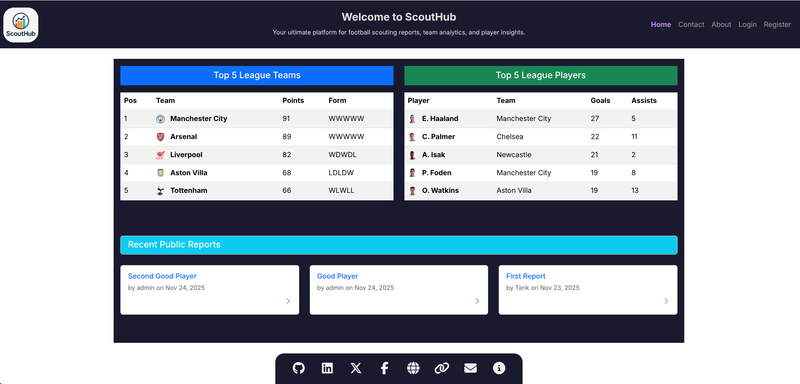
</div>

📑
## Table of Contents
1. [💡 Rationale and Purpose](#rationale-and-purpose)
2. [✨ Features](#features)
3. [🧠 User Experience (UX) & Accessibility](#user-experience-ux--accessibility)
4. [📱 Responsiveness](#responsiveness)
5. [🛠️ Technologies Used](#technologies-used)
6. [📂 File Structure](#file-structure)
7. [🧰 Code Structure and Logic](#code-structure-and-logic)
8. [💾 Database Schema (ERD)](#database-schema-erd)
9. [🚀 Deployment](#deployment)
10. [⚙️ Testing](#testing)
11. [🚀 Development Walkthrough](#development-walkthrough)
12. [🌱 Future Improvements](#future-improvements)
13. [🤝 Contributing](#contributing)
14. [📝 Credits](#credits)
15. [⚖️ License](#license)

---

💡
## Rationale and Purpose

The primary goal of ScoutHub is to empower football enthusiasts, scouts, and analysts with a centralized platform to manage and analyze critical player and team data. It addresses the need for an intuitive tool to:

-   **Centralize Scouting Data:** Provide a dedicated space for users to create, store, and manage their personal scouting reports, moving beyond scattered notes and spreadsheets.
-   **Leverage Real-time Data:** Integrate with external football APIs to ensure reports and analysis are based on up-to-date league standings, team performance, and player statistics.
-   **Enhance Decision-Making:** Offer tools that facilitate deeper analysis of player attributes and team dynamics, aiding in informed decision-making for talent identification and tactical planning.
-   **Streamline Workflow:** Simplify the process of report creation, editing, and organization, saving time for busy scouts and enthusiasts.

Ultimately, ScoutHub aims to be an indispensable resource for anyone serious about understanding and evaluating football talent.

---

✨
## Features

### Core Functionality
-   **User Authentication:** Secure registration, login, and logout functionalities.
-   **Dashboard:** Personalized dashboard for logged-in users to manage their reports.
-   **Homepage Data Display:** Dynamically displays top 5 league teams (with position, points, form) and top 5 players (with goals, assists) from a selected league.
-   **Scouting Report Management (CRUD):**
    -   **Create:** Users can create new scouting reports using a dynamic form where team selection populates relevant players. Includes client-side validation and a disabled save button until the form is complete.
    -   **Read (List):** View a paginated list of all created reports on the user dashboard.
    -   **Read (Detail):** Access a detailed view for individual reports.
    -   **Edit:** Modify existing reports via a pre-filled form with data validation and success messages.
    -   **Delete:** Users can easily delete their own scouting reports with a clear 'Delete' button.
    -   **Confirmation:** A confirmation prompt appears to prevent accidental deletions.

-   **Data Synchronization:** Management command to fetch and update football data from the API, respecting rate limits.

---

🧠
## User Experience (UX) & Accessibility

ScoutHub is designed with a focus on delivering a smooth and intuitive user experience (UX) for all users, alongside robust accessibility (A11y) to ensure broad usability.

### User Experience (UX)
The application guides users through a clear and logical flow:
-   **Browse** available football data on the homepage.
-   **Register/Login** to unlock personalized features.

<div align="center">
    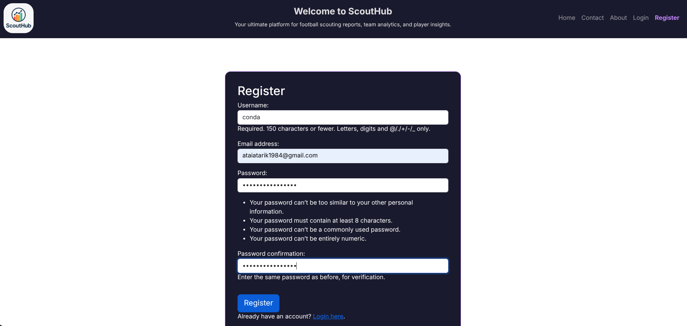
</div>

<div align="center">
    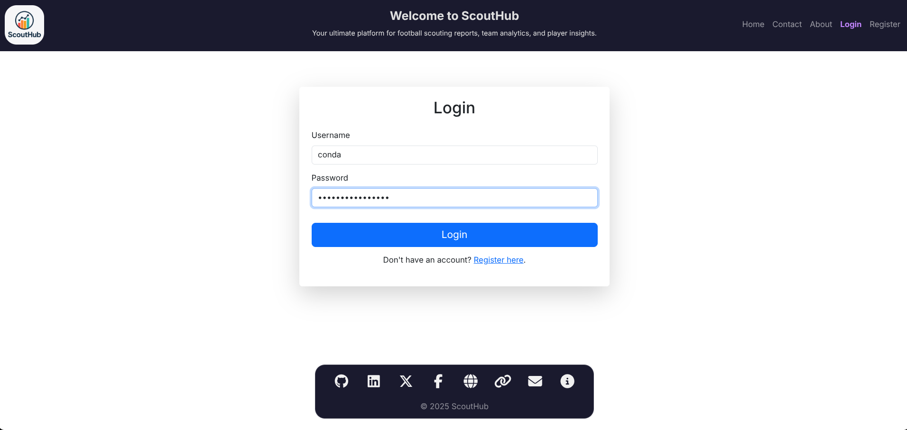
</div>

-   **Manage Reports**: Create, Read, Update, Delete personal scouting reports.

<div align="center">
    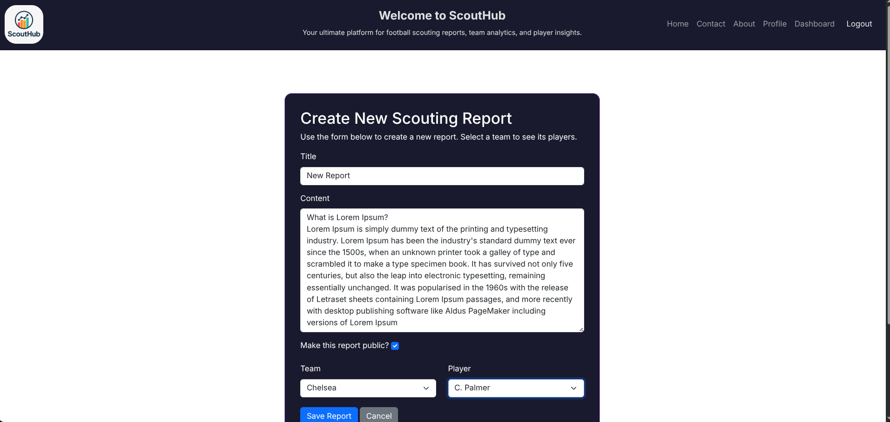
</div>

<div align="center">
    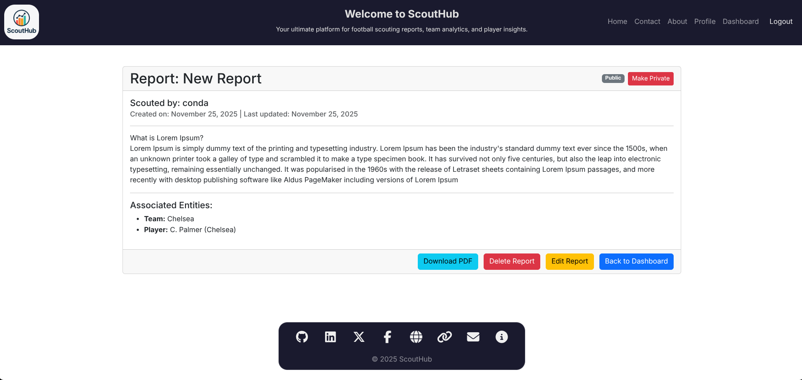
</div>

-   **Download Reports**: Generate PDF versions of scouting reports for offline use.

<div align="center">
    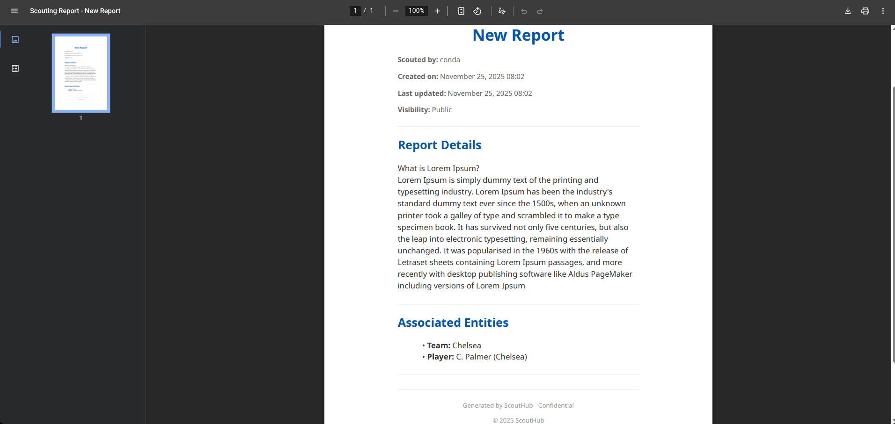
</div>

Key UX principles applied include:
-   **Clarity**: Simple and direct language, intuitive navigation.
-   **Feedback**: Immediate visual feedback for user actions (e.g., form validation, success messages).
-   **Consistency**: Uniform design elements and interaction patterns throughout the application.
-   **User Control**: Users are in control of their actions, with clear options for undoing or confirming critical operations.

### Accessibility Features
ScoutHub is built with accessibility in mind, utilizing fundamental semantic HTML5 elements to ensure a clear and navigable structure for all users, including those using assistive technologies.

-   **Semantic Structure**: Key elements like `<header>`, `<nav>`, `<main>`, `<section>`, `<footer>`, `<button>`, `<a>`, and form elements are used appropriately to convey meaning and structure.
-   **Color Contrast**: Accessible color palettes are chosen to maintain sufficient contrast between text and background, aiding readability for users with visual impairments.
-   **Clear Navigation**: Logical tab order for keyboard navigation and clear focus indicators for interactive elements.
-   **Accessible Forms**: Form fields are properly labeled and associated using `<label>` tags, and error messages are clearly conveyed.
-   **ARIA Attributes**: Applied sparingly where native HTML semantics are insufficient to enhance the experience for assistive technologies (e.g., `aria-label` for descriptive buttons).
-   **Responsive Design**: Ensures usability across diverse devices and screen sizes (detailed in the Responsiveness section).

---

📱
## Responsiveness

ScoutHub is designed to be fully responsive, providing an optimal viewing and interaction experience across a wide range of devices, from desktops to mobile phones.

### Strategy
The application was developed using a **Mobile-First** approach. This means styles were first written for small screens, and then scaled up for larger screens using `min-width` media queries. This ensures a seamless experience on any device. The layout is built on a flexible grid system provided by Bootstrap 5, allowing components to reflow and resize gracefully.

### Screenshot


**DESKTOP**

---

<div align="center">
    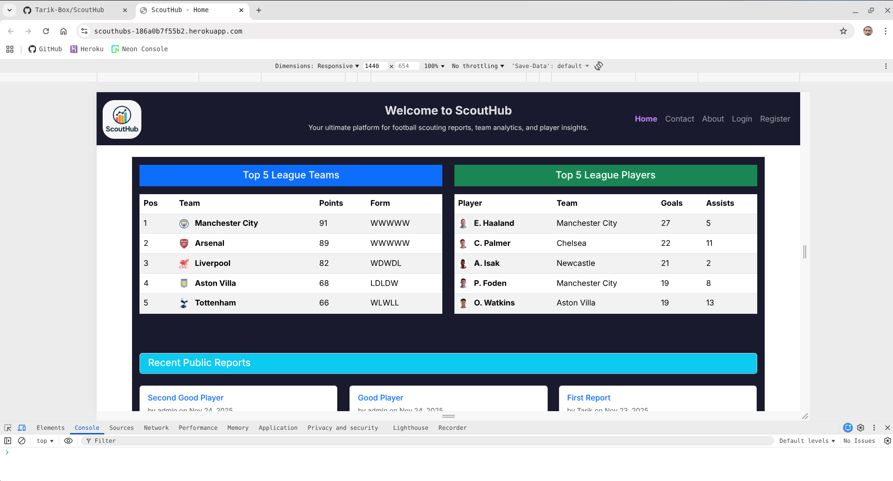
</div>

---

**TABLET**

---

<div align="center">
    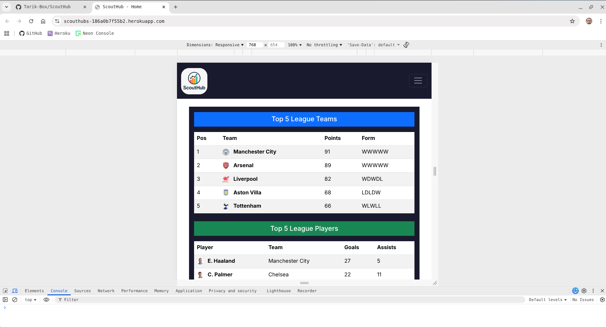
</div>

---

**MOBILE**

---

<div align="center">
    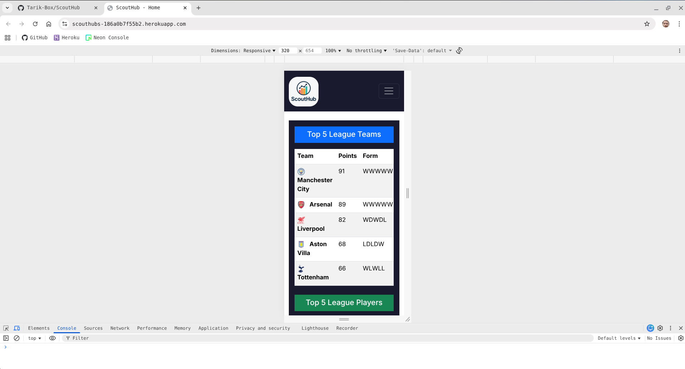
</div>

---
🛠️
## Technologies Used

This project utilizes the following key technologies to deliver its features:

-   **Python 3.13**: The core programming language.
-   **Django**: The high-level Python Web framework.
-   **PostgreSQL**: The robust relational database management system.
-   **API-Football v3**: The external API providing comprehensive football data. *Note: The API-KEY used is a free key, so data may not always be the most up-to-date. You can get a free API_KEY [here](https://www.api-football.com/).*
-   **HTML5**: For semantic document structure.
-   **CSS3**: For styling, layout, and responsiveness, leveraging **Bootstrap 5**.
-   **JavaScript (Vanilla JS)**: For client-side interactivity and dynamic form elements.
-   `python-decouple`: For secure management of environment variables.
-   `requests`: A popular HTTP library for making API calls.
-   `dj-database-url`: Simplifies database configuration by parsing connection strings.
-   `whitenoise`: For efficiently serving static files in production.
-   `gunicorn`: A production-ready WSGI HTTP server for deploying Django applications.
-   `Black`: An uncompromising Python code formatter, ensuring consistent code style.
-   **Font Awesome**: For scalable vector icons.
-   **Google Fonts (Inter)**: Used for consistent and modern typography.

---

📂
## File Structure

A high-level overview of the ScoutHub project's directory structure.

```
ScoutHub/
├── .venv/                   # Python virtual environment
├── accounts/                # Handles user authentication and profiles
├── assets/                  # Static assets like documentation images
├── core/                    # Manages core football data and API integration
├── dashboard/               # User-specific dashboard features
├── reports/                 # Manages scouting report CRUD operations
├── scout_hub/               # Main Django project settings and URLs
├── web/                     # General website pages (home, about, contact)
├── .gitignore               # Files/directories ignored by Git
├── manage.py                # Django's command-line utility
└── requirements.txt         # Python dependencies
```

---
🧰
## Code Structure and Logic

This section provides insights into the overall architecture, key design patterns, and how different components of the ScoutHub application interact to deliver its functionality.

### Architectural Overview
ScoutHub is built upon the Django framework, which inherently follows a Model-View-Controller (MVC) architectural pattern, though Django often refers to it as Model-View-Template (MVT). Each application (`accounts`, `core`, `web`, `reports`, `dashboard`) within the project encapsulates a specific set of functionalities, promoting modularity and separation of concerns.

-   **Models (M)**: Defined in `models.py` within each app, these represent the data structure (e.g., `User`, `Team`, `Player`, `Report`). They handle data validation and interaction with the PostgreSQL database.
-   **Views (V)**: Implemented in `views.py`, these Python functions or classes receive web requests, interact with models to fetch/update data, process business logic, and determine which template to render in response.
-   **Templates (T)**: Stored in `templates/` directories, these HTML files (with Django's templating language) define the user interface. They display data passed from views and collect user input via forms.
-   **Forms**: Django Forms (`forms.py`) handle input validation and rendering, acting as an intermediary between views and templates.
-   **URLs**: Defined in `urls.py`, these map URL patterns to specific views, directing web traffic within the application.

### Key Logic Flow
The application's primary data flow involves:

1.  **API Data Ingestion**: The `core/management/commands/fetch_football_data.py` command fetches real-time football data (teams, players, standings) from API-Football v3, processing and storing it in the PostgreSQL database via `core/api_client.py` and the `core/models.py`.
2.  **User Authentication**: The `accounts` app manages user registration, login, and logout, utilizing Django's built-in authentication system and custom forms.
3.  **Homepage Display**: The `web` app's views query the `core` models to retrieve and display top league teams and players on the homepage.
4.  **Scouting Report Lifecycle**:
    *   **Creation**: Users access a form (from `reports/forms.py`) rendered by `reports/views.py`. Client-side JavaScript (`reports/static/reports/js/report_form.js`) dynamically populates player dropdowns based on team selection. Validated data is saved to `reports/models.py`.
    *   **Viewing/Editing/Deletion**: Reports are retrieved, displayed, and modified through views and templates in the `reports` app. Updates involve form validation, and deletions include confirmation steps.
5.  **User Profiles**: The `accounts` app's `profile_view` allows logged-in users to manage their basic account information (username, email) and extended profile details (`Profile` model).

---

💾
## Database Schema (ERD)

Here is a breakdown of the main data relationships in ScoutHub:

**User and Profile Relationship:**

```
[ User ]
   |
   +-- (has one) -------> [ Profile ]  (One-to-One)
```

**User and Report Relationship:**

```
[ User ]
   |
   +-- (creates many) --> [ Report ]   (One-to-Many)
```

**Team and Player Relationship:**

```
[ Team ]
   |
   +-- (has many) ------> [ Player ]   (One-to-Many)
```

**Report, Team, and Player Relationships:**

```
[ Report ]
   |
   +-- (references many) <--> [ Team ]     (Many-to-Many)
   |
   +-- (references many) <--> [ Player ]   (Many-to-Many)
```

You can see the initial ERD concept on the [Paper Work page](#1-paper-work) in the Development Walkthrough section.

---

🚀
## Deployment

Deploying ScoutHub to a production environment involves several key steps to ensure it runs efficiently and is accessible to users. This guide outlines the process for deployment using Heroku.

### Prerequisites for Heroku Deployment
-   A Git repository (e.g., GitHub) with your project code.
-   A Heroku account and the Heroku CLI installed.
-   A PostgreSQL database service (Heroku provides PostgreSQL add-ons).
-   All dependencies listed in `requirements.txt`.

### Heroku Deployment Process

1.  **Prepare `settings.py` for Production**:
    *   Set `DEBUG = False`.
    *   Configure `ALLOWED_HOSTS` to include your Heroku app's domain (e.g., `your-app-name.herokuapp.com`).
    *   Ensure `SECRET_KEY` is retrieved from environment variables.
    *   Configure static file serving using `whitenoise`.
    *   Ensure database configuration uses environment variables (`dj-database-url`).

2.  **Create Configuration Files**:
    -   **`Procfile`**: Create this file in the root of your project to tell Heroku how to run your application.
        ```
        web: gunicorn scout_hub.wsgi --log-file -
        ```
    -   **`.python-version`**: Create this file in the root directory to specify the Python runtime. While Heroku has historically used `runtime.txt`, their build system now recommends `.python-version` for future compatibility.
        ```
        3.13
        ```

3.  **Install Gunicorn & Whitenoise**:
    Ensure `gunicorn` and `whitenoise` are in your `requirements.txt`.
    ```bash
    pip install gunicorn whitenoise dj-database-url
    pip freeze > requirements.txt
    ```

4.  **Create Heroku App**:
    Log in to Heroku via CLI and create a new app:
    ```bash
    heroku login
    heroku create your-app-name
    ```

5.  **Add Heroku Postgres Add-on**:
    Attach a PostgreSQL database to your Heroku app:
    ```bash
    heroku addons:create heroku-postgresql:hobby-dev -app your-app-name
    ```

6.  **Configure Environment Variables on Heroku**:
    Set your API key and Django's secret key on Heroku:
    ```bash
    heroku config:set API_KEY="your_api_football_v3_key_here" -app your-app-name
    heroku config:set SECRET_KEY="a_strong_random_secret_key" -app your-app-name
    ```

7.  **Push to Heroku**:
    Deploy your code to Heroku:
    ```bash
    git push heroku main
    ```

<div align="center">
    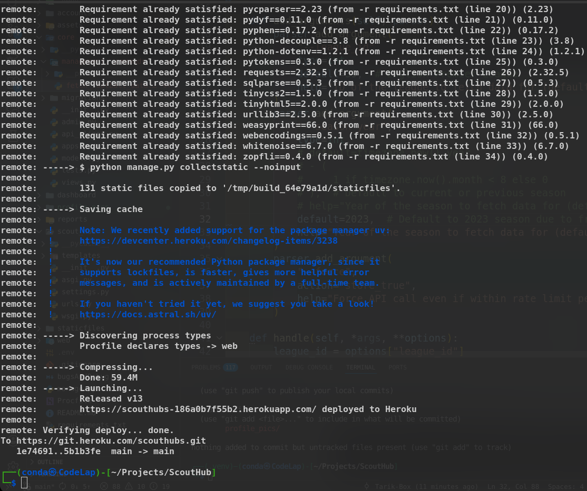
</div>

8.  **Run Post-Deployment Commands**:
    Execute database migrations and populate initial data on Heroku:
    ```bash
    heroku run python manage.py migrate -app your-app-name
    heroku run python manage.py fetch_football_data --force -app your-app-name
    ```

<div align="center">
    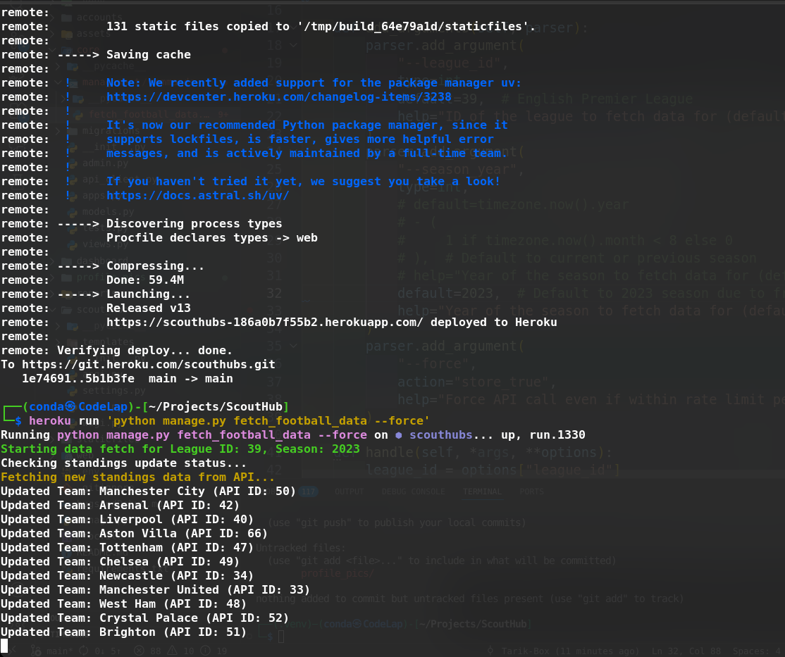
</div>

Your ScoutHub application should now be live and accessible at your Heroku URL. 

---

⚙️
## Testing

This section details the testing methodologies used to ensure the quality and reliability of ScoutHub.

### Manual Testing
Manual testing was conducted extensively throughout the development lifecycle to ensure all features met the specified requirements and provided a positive user experience. This involved:

-   **Feature Testing**: Each implemented feature (e.g., user registration, report creation, PDF export) was tested against its acceptance criteria.
-   **User Interface (UI) Testing**: Verification of layout, styling, and responsiveness across different devices and browsers.
-   **User Experience (UX) Flow Testing**: Ensuring intuitive navigation and interaction flows for all user journeys.
-   **Error Handling Testing**: Deliberate triggering of error conditions (e.g., invalid form submissions, missing data) to verify appropriate feedback and system stability.

Here is a comprehensive testing checklist to ensure all functionalities work as intended:

#### **Part 1: Unauthenticated Visitor**

As a logged-out visitor, test the following:

-   **[ ] Homepage:**
    -   [ ] Does the homepage load correctly?
    -   [ ] Are the "Top 5 League Teams" and "Top 5 League Players" sections visible and populated with data?
    -   [ ] Do the main navigation links (`Home`, `About`, `Contact`) work?
    -   [ ] Does the `Register` button take you to the registration page?
    -   [ ] Does the `Login` button take you to the login page?
    -   [ ] Do the footer links work?
    -   [ ] Does the "Go to Top" button appear when you scroll down and work when clicked?

-   **[ ] Other Public Pages:**
    -   [ ] Does the `About` page load with the correct content?
    -   [ ] Does the `Contact` page load correctly?

-   **[ ] Responsiveness:**
    -   [ ] Resize your browser window (or use browser developer tools) to simulate a tablet and a mobile phone.
    -   [ ] Check the `Home`, `About`, `Contact`, `Login`, and `Register` pages on each size. Does the layout adjust correctly? Is all content readable and usable?

---

#### **Part 2: Authenticated User**

Create a brand new account and log in to test this flow.

-   **[ ] User Registration:**
    -   [ ] Create a new account with a unique username and email.
    -   [ ] **Expected Result:** You are successfully registered, logged in automatically, and redirected to the homepage.
    -   [ ] Try to register again with the *same* username/email.
    -   [ ] **Expected Result:** You should see validation errors preventing the duplicate account creation.

-   **[ ] Login & Logout:**
    -   [ ] Log out from your new account.
    -   [ ] Log back in using the credentials you just created.
    -   [ ] **Expected Result:** You are successfully logged in. The navbar now shows `Dashboard`, `Profile`, and `Logout`.
    -   [ ] Click `Logout`.
    -   [ ] **Expected Result:** You are successfully logged out.

-   **[ ] Scouting Reports (Full CRUD):**
    -   [ ] **(Create)** Go to the `Dashboard` and click "Create New Report".
    -   [ ] **(Create)** Select a team from the dropdown. Does the "Player" dropdown update with the correct players for that team?
    -   [ ] **(Create)** Fill out all fields and save the report.
    -   [ ] **Expected Result:** The report is saved, you see a success message, and the new report appears on your dashboard.
    -   [ ] **(Read)** Click the title of the new report on your dashboard. Does it take you to the correct report detail page?
    -   [ ] **(Update)** On the detail page, click "Edit Report". Change the title or content and save.
    -   [ ] **Expected Result:** The report is updated, and you see the changes on the detail page.
    -   [ ] **(Visibility)** On the detail page, toggle the visibility from "Private" to "Public" or vice-versa. Does the status update correctly?
    -   [ ] **(PDF)** On the detail page, click "Download PDF".
    -   [ ] **Expected Result:** A PDF of the report is downloaded.
    -   [ ] **(Delete)** On the detail page, click "Delete Report" and confirm.
    -   [ ] **Expected Result:** The report is deleted, and it no longer appears on your dashboard.

-   **[ ] User Profile:**
    -   [ ] Go to the `Profile` page.
    -   [ ] Update your bio and other fields.
    -   [ ] Click "Update Profile".
    -   [ ] **Expected Result:** A success message appears, and all your *text-based* information (bio, etc.) is updated correctly.
    -   [ ] **Note:** The profile picture field is for presentation only; actual image files are not stored or uploaded on this deployment.

---

#### **Part 3: Django Admin (Superuser)**

Log in to the `/admin/` URL with your superuser account.

-   **[ ] Admin Functionality:**
    -   [ ] Can you see all the models (`Users`,  `Teams`, `Players`, `Reports`, etc.)?
    -   [ ] Can you view the details of the test user you created above ?
    -   [ ] **(Critical)** Select that test user and delete them using the admin "action" dropdown.
    -   [ ] **Expected Result:** The user is deleted successfully .

An example of a test case for a core feature with "Expected Result and the Actual Result after the test is done:

| Feature                 | Test Case Description                                 | Steps                                                                                                                                                                                                                                                                                                    | Expected Result                                                                                                                                         | Actual Result |
| :---------------------- | :---------------------------------------------------- | :------------------------------------------------------------------------------------------------------------------------------------------------------------------------------------------------------------------------------------------------------------------------------------------------------- | :------------------------------------------------------------------------------------------------------------------------------------------------------ | :------------ |
| **User Registration**   | Successful User Account Creation                      | 1. Navigate to the registration page.<br>2. Fill in valid username, email, and password.<br>3. Click 'Register'.                                                                                                                                                                                        | User is registered, automatically logged in, and redirected to the homepage/dashboard with a success message. | Pass          |
| **Scouting Report CRUD**| Create a new report                                   | 1. Log in as a registered user.<br>2. Click  'Create New Report'.<br>3. Fill in title, content.<br>4. Select a team and player.<br>5. Click 'Save Report'.                                                                                                                                          | Report is successfully created, displayed on the dashboard, and a success message is shown.                                                               | Pass          |
| **PDF Export**          | Export existing report to PDF                         | 1. Log in as the report owner.<br>2. Navigate to a report's detail page.<br>3. Click 'Download PDF'.                                                                                                                                                                                                     | A PDF version of the report is downloaded, accurately reflecting the report's content and formatting. | Pass          |

*Note: This table represents a high-level overview. Comprehensive manual testing involved a wider array of scenarios and edge cases not fully detailed here.*

### Automated Testing
Automated testing is crucial for maintaining code quality and preventing regressions in the long run. For ScoutHub, the automated testing suite will include:

-   **Unit Tests (Python/Django)**:
    -   Tests for models to ensure data integrity and custom methods function correctly.
    -   Tests for forms to validate input processing and error handling.
    -   Tests for views to verify correct logic, context passing, and template rendering.
    -   Example of how to run: `python manage.py test <app_name>`


## Example Automated Test Case

To demonstrate the setup and functionality of automated testing, a unit test was created for the `Profile` model in the `accounts` application. This test verifies the correct behavior of the `__str__` method.

**Test File:** `accounts/tests.py`

```python
from django.test import TestCase
from django.contrib.auth import get_user_model
from accounts.models import Profile

User = get_user_model()


class ProfileModelTest(TestCase):
    """Test case for the Profile model."""

    def setUp(self):
        """Set up a user and profile for testing."""
        self.user = User.objects.create_user(
            username="testuser", email="test@example.com", password="testpassword"
        )
        self.profile = Profile.objects.get(user=self.user)

    def test_profile_str_method(self):
        """Test the __str__ method of the Profile model."""
        self.assertEqual(str(self.profile), f"{self.user.username} Profile")

```

**How to run this test:**

```bash
python manage.py test accounts.tests.ProfileModelTest
```

**Expected Output:**

```
Creating test database for alias 'default'...
System check identified no issues (0 silenced).
.
----------------------------------------------------------------------
Ran 1 test in X.XXXs

OK
Destroying test database for alias 'default'...
```
<div align="center">
    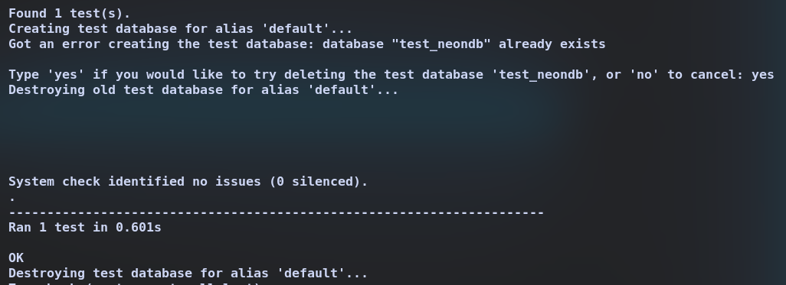
</div>

*(Note: An `OperationalError` during database destruction is a known, benign issue with PostgreSQL when other connections exist, but the test itself passes.)*

<div align="center">
    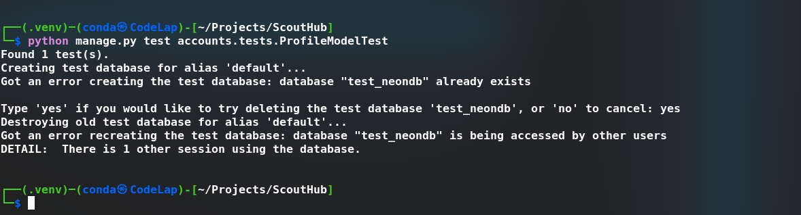
</div>

### Code Style Validation
To maintain a high standard of code quality and consistency, the following tools and standards are used:

-   **Python**: The `Black` code formatter is used to enforce a strict, consistent style across the entire Python codebase.
    -   Verification: `/home/conda/Projects/ScoutHub/.venv/bin/python -m black --check .`
    -   Auto-fix: `/home/conda/Projects/ScoutHub/.venv/bin/python -m black .`
    -   Linting (Flake8): `/home/conda/Projects/ScoutHub/.venv/bin/python -m flake8 --max-line-length=88 <path_to_file>`
-   **HTML/CSS**: Validation against W3C standards ensures cross-browser compatibility and best practices.
    -   HTML validation for `base.html` and other templates.
    -   CSS validation for `style.css`.

All code is periodically reviewed against these standards to maintain high quality.


**HTML**

<div align="center">
    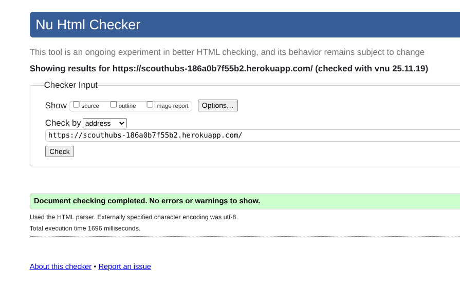
</div>

---

**CSS**

<div align="center">
    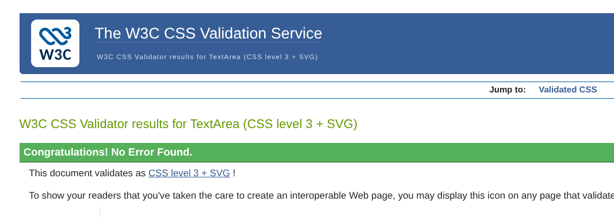
</div>

---

**Google Lighthouse**

<div align="center">
    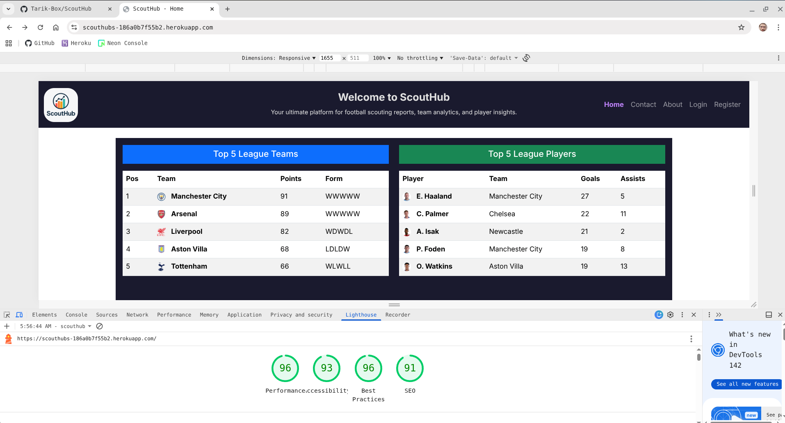
</div>

---

**Flake8**

Most, if not all, the flake8 warnings have been resolved. 
Below is a screenshot of the flake8 output, indicating that the Python code is linted.
Remaining warnings are primarily for unavoidable line-length issues.

<div align="center">
    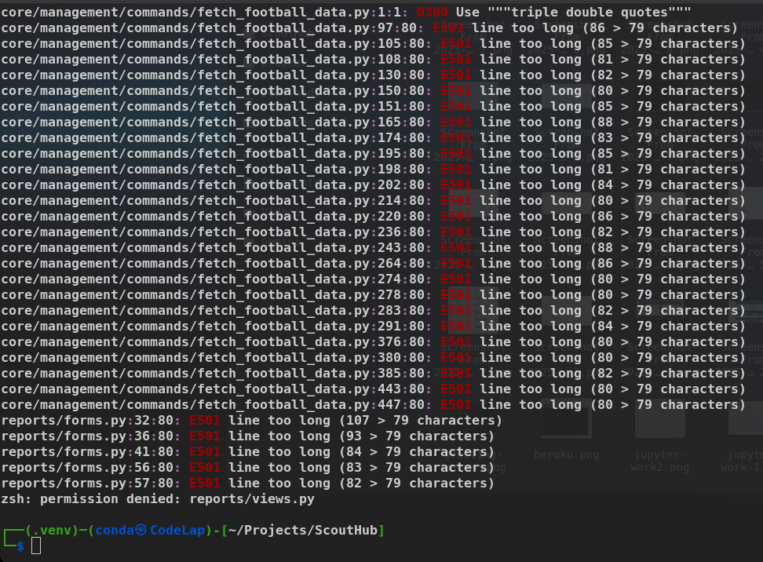
</div>

---


**Black**

Below is a screenshot of the `Black` formatter output confirming that the Python code is consistently formatted and requires no further changes.

<div align="center">
    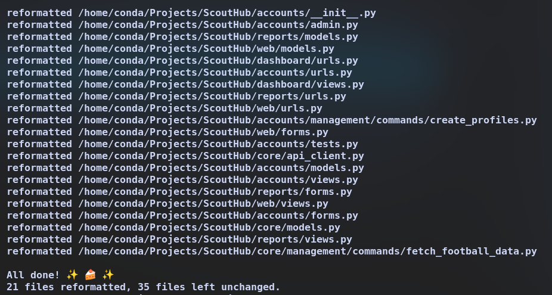
</div>

---


🚀
## Development Walkthrough

This section details the journey of ScoutHub, from initial concepts to a live application, touching upon design, agile methodologies, and bug resolution.

### 1: Paper Work
Here's where it all began, sketching out the core ideas and structure before a single line of code was written.
-   **Idea**: The initial spark – a platform for football scouting.
-   **Design**: High-level concepts and user flows.
-   **ERD (Entity-Relationship Diagram)**: Mapping out the database structure.
-   **Wireframe**: Basic visual layouts to understand user interface.

<div align="center">
    
</div>

---

### 2: Figma
Translating initial sketches into more refined digital designs.

<div align="center">
    
</div>

<div align="center">
    
</div>

---

### 3: Agile Board
Our development process followed an Agile approach, managing tasks and user stories on a GitHub Project board.
💡 [Project Board](https://github.com/users/Tarik-Box/projects/12)

<div align="center">
    
    
    
</div>

---

### 4: Bringing the Idea to Life
Getting the project off the ground with Django's modular application structure.
-   `accounts`: Handles user authentication and profiles.
-   `core`: Manages core football data models and API integrations.
-   `web`: Contains general website pages like the homepage.
-   `reports`: Manages the CRUD operations for scouting reports.
-   `dashboard`: Provides the user-specific dashboard.

---

### 5: Bugs and Debugging
A look at some challenges encountered and their resolutions.

<div align="center">
    
    <p><em>**Bug:** Player images were not displaying. <br> **Fix:** Corrected the template tag from `player.image.url` to the correct model property `player.image_url`.</em></p>
</div>

<div align="center">
    
    <p><em>**Bug:** A `NoReverseMatch` error occurred on the login link. <br> **Fix:** Resolved by using a namespaced URL in the template: ``.</em></p>
</div>

<div align="center">
    
    <p><em>**Bug:** The dynamic player dropdown remained empty after selecting a team. <br> **Fix:** The JavaScript `querySelector('form')` was too generic. Resolved by targeting the form with a unique ID selector: `#create-report-form`.</em></p>
</div>

---

### 6: Comes to Life
The working application in action.

<div align="center">
    
    
    
    
</div>

---

🌱
## Future Improvements

-   **Advanced Search and Filtering**: For scouting reports based on player attributes, team, date, or ratings.
-   **User Collaboration**: Features for sharing reports with other users or teams.
-   **Notifications**: Alerts for new player data or comments on shared reports.
-   **Statistical Visualization**: Charts and graphs for player performance trends.
-   **PDF Report Customization**: Allow users to customize the layout of generated PDF reports.

---

🤝
## Contributing

We welcome contributions! Please follow these guidelines:
1.  **Fork the Repository**: From `https://github.com/Tarik-Box/ScoutHub`.
2.  **Work on a Feature/Fix**: Create a new branch and test your changes.
3.  **Commit Your Work**: Use clear commit messages.
4.  **Submit a Pull Request**: Propose your changes for review.

### Code Style
-   **Python**: We stick to [PEP 8](https://www.python.org/dev/peps/pep-0008/) and use `Black` for formatting.
-   **HTML/CSS/JS**: Keep it consistent with the existing code.

---

📝
## Credits

This project was developed by **Tarik Box**.

### Key Libraries and Resources
-   **Django**: The web framework that powers ScoutHub.
-   **psycopg2-binary**: PostgreSQL adapter for Python.
-   **python-decouple**: For managing environment variables.
-   **requests**: For making API calls.
-   **whitenoise**: For serving static files in production.
-   **gunicorn**: Production-ready WSGI server.
-   **API-Football v3**: The external API providing football data.
-   **Bootstrap 5**: For responsive, mobile-first design.
-   **Gemini-Cli**: For assistance with code explanation, debugging, and project documentation.

### External Links
-   [Corey Schafer's Django Playlist](https://www.youtube.com/watch?v=UmljXZIypDc&list=PL-osiE80TeTtoQCKZ03TU5fNfx2UY6U4p)
-   [Dennis Ivy's Django Crash Course on Traversy Media](https://www.youtube.com/watch?v=PtQiiknWUcI&t=16163s)
-   [Django Docs](https://docs.djangoproject.com/en/5.2/)
-   [Stack Overflow](https://stackoverflow.com)

---

⚖️
## License

This project is licensed under the MIT License - see the `LICENSE` file for details.
